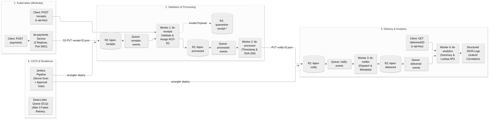

# Capstone Scope Document

Anm-hub · KijaniKiosk End-to-End Delivery

Anastacia Mwangi

## Problem Statement
Nia's Week 10 ticket says synchronous receipt generation inside kk-payments adds about 800 ms to every payment response and can fail the payment itself. The Week 10 receipt chain exists only as a local mock, with no authenticated entry point, no retry or dead-letter path, and no delivery pipeline. kk-payments (Week 8, on Kubernetes) has no way to emit receipt events. This capstone delivers a decoupled, observable receipt pipeline on a free cloud tier, fed by kk-payments and deployed through a pipeline with a human approval gate. (No Week 10 gap analysis was written; the problem is taken from the ticket and from gaps found while building.)

## Track
Track B, serverless-first, on Cloudflare Workers, R2 and Queues.

## What I Will Build
1. Four Workers (kk-receipts, kk-processor, kk-notifier, kk-analytics) chained by R2 event notifications and Queues, with a dead-letter queue and the order ID as correlation ID in every log line.
2. Idempotent scripts that provision buckets, queues and notification rules, then deploy and smoke-test a stage from templated Wrangler configs.
3. A Jenkins pipeline: static checks and secret scan, staging deploy and smoke test, an approval gate recording approver and reason, then production deploy and smoke test.
4. A `POST /payments` endpoint on kk-payments that writes receipt objects to R2, deployed on Minikube with ConfigMap, Secret, probes, resource limits and a rolling-update strategy.
5. An AI-use log and the six-point governance checklist assessed against the deployed stack.

## Out of Scope
- Terraform, Ansible and Prometheus (Track A): not part of Track B.
- Real SMS or email delivery and a payment database: the notifier logs only, to keep the chain demonstrable without third-party accounts.
- Pulling the image from a registry into Minikube: the image is loaded with `minikube image load`, because registry auth would cost time better spent on the pipeline.
- Guaranteed African data residency: R2 offers no kenyan location option,so this is documented as a known limitation.

## Success Criteria
1. One authenticated `POST /payments` through the Minikube service produces, within 60 seconds, a record at the analytics `/delivered/<orderId>` endpoint, and the same `orderId` appears in structured log lines from all four Workers.
2. A push to `main` runs staging deploy and smoke test before the approval prompt appears; the prompt requires a named approver and a reason, both saved in `approval.txt`; a deliberately broken config stops the pipeline before approval and production.
3. A malformed receipt is quarantined and logged `receipt.rejected` while a valid order sent afterwards still completes, and a credential search of the repo, git history and build logs finds zero hits.

## Architecture Diagram

